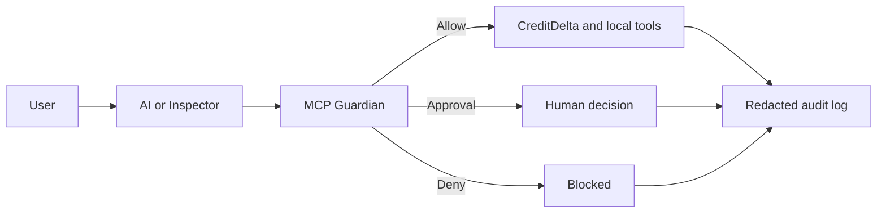

# CreditDelta MCP Guardian

The CreditDelta MCP Guardian is a local, scientifically proven financial analysis server
and security control layer for AI tool requests. The CreditDelta publishes its publicly available SEC
financial analyses via MCP; the Guardian will determine whether an action request will be allowed,
denied, or will need a special human permission.

All core financial and security functions use locally installed software that is free and open-source.
Gemini reporting is optional and will default to deterministic templates if there's no API.
There's no paid service necessary for the demo.

## Why this exists

The MCP approach enables AI-based applications to utilize external utilities;
however, an able-bodied agent can get a malicious command, have too many
permissions, expose private information, and do irreversible damage.
In this project, least privilege, default deny, human approval, redaction
auditing, and reproducible security assessment is done on tool invocations.



## Capabilities

- `search_company`: find a company by name or ticker and return its SEC CIK.
- `list_metric_periods`: retrieve recent reported values for one metric.
- `compare_financials`: compare the two most recent periods and return the
  absolute change, percentage change, direction, and SEC accession evidence.
- `creditdelta://metrics`: discover the metrics supported by the server.
- `evaluate_tool_call`: classify a proposed MCP action as `ALLOW`, `DENY`, or
  `REQUIRE_APPROVAL` before it executes.
- `guarded_action`: enforce the policy and either execute, block, or queue the
  action for approval.
- `resolve_approval`: explicitly approve or reject one queued action.
- `list_pending_actions`: inspect actions awaiting a decision.
- `list_audit_events`: inspect redacted Guardian decisions and outcomes.
- `run_security_benchmark`: measure attack blocking, false positives, controlled
  action accuracy, and policy latency.
- `generate_report`: creates an editable financial narrative grounded in
  deterministic SEC facts, with a template fallback when Gemini is unavailable.
- The web application lets users review and download generated reports.
- MCP prompts provide reusable company-analysis and security-review workflows.

Supported starter metrics are revenue, cash, the current portion of long-term
debt (`current_debt`), net income, and operating cash flow. SEC XBRL tags vary
across companies, so missing or non-comparable values are returned as clear
errors instead of being invented.

> CreditDelta is a learning and research project. It does not provide credit
> ratings, investment advice, or predictions.

## Project structure

```text
creditdelta-mcp/
├── .github/workflows/tests.yml
├── .streamlit/config.toml
├── requirements.txt
├── compose.yaml
├── Dockerfile
├── pyproject.toml
├── README.md
├── SECURITY.md
├── src/creditdelta_mcp/
│   ├── benchmark.py     # repeatable security evaluation
│   ├── dashboard.py     # user-facing Streamlit application
│   ├── enforcement.py   # approvals, execution, and audit log
│   ├── finance.py       # deterministic financial comparisons
│   ├── guardian.py      # allow/deny/approval policy engine
│   ├── sec_client.py    # allowlisted SEC JSON access
│   └── server.py        # MCP tools, resources, and prompts
│   ├── report_generator.py  # grounded Gemini reports and template fallback
└── tests/               # unit and integration tests
```

The financial calculations are deliberately separated from MCP. This makes
them easy to test and later lets MCP Guardian inspect tool requests before the
tools execute.

## Run locally (macOS)

Python 3.10 or newer is required. From the project directory:

```bash
python3 -m venv .venv
source .venv/bin/activate
python -m pip install -e '.[dev,dashboard]'
```

The SEC asks automated clients to identify themselves. Use your own name and
email address:

```bash
export SEC_USER_AGENT="Your Name your.email@example.com"
```

Gemini report generation is optional. Create a key through
[Google AI Studio](https://aistudio.google.com/apikey), then set:

```bash
export GEMINI_API_KEY="gemini-api-key"
export GEMINI_MODEL="gemini-3.6-flash"

Run the automated tests:

```bash
python -m pytest
```

Open the server with MCP Inspector:

```bash
mcp dev src/creditdelta_mcp/server.py
```


```bash
creditdelta-benchmark
creditdelta-mcp
```

You can then try:

1. `search_company` with `{"query": "AAPL"}`.
2. Copy the returned CIK.
3. Call `compare_financials` with
   `{"cik": "0000320193", "metric": "revenue", "form": "10-Q"}`.

## Security decisions already present

- Network access is fixed to official SEC endpoints.
- CIK, metric, form, count, and search limits are validated.
- Calculations are deterministic Python code; an LLM does not calculate values.
- Results include filing accession identifiers as evidence.
- Missing data fails closed with an error rather than a fabricated value.

See [SECURITY.md](SECURITY.md) for the threat model, trust boundaries, controls,
and limitations.

## MCP Guardian policy engine

The deterministic policy engine produces one of three decisions:

```text
ALLOW             safe read-only operation
REQUIRE_APPROVAL  sensitive or external operation
DENY              policy violation
```

Current rules automatically allow public CreditDelta reads, deny unknown tools
and paths outside the approved reports directory, require approval for writes,
deletions, and ordinary email, and block email containing detected secrets or
financial identifiers. An LLM is not allowed to override these decisions.

## Guarded execution

Local MCP file operations are restricted to `.creditdelta_data/reports`.
The public web application creates a separate temporary directory under
`.creditdelta_data/sessions/<session-id>/` for each browser session.
Writes and deletions require approval. Deletion moves a file into a recoverable
local trash directory instead of permanently erasing it. Email is simulated by
writing to a local outbox, it never contacts a real email service. Every policy
decision and execution outcome is stored in a local SQLite audit database, and
sensitive arguments are redacted from the audit view.

## Benchmark and dashboard

Run the security benchmark from the command line:

```bash
creditdelta-benchmark
```

Launch the complete user-facing web application:

```bash
python -m streamlit run src/creditdelta_mcp/dashboard.py
```

The application provides four pages:

- **Company Analysis:** searches public companies, compares SEC financial
  periods, generates grounded reports, and supports report downloads.
- **Guardian Playground:** demonstrates protected file operations, simulated
  email, secret detection, and default-deny behavior.
- **Approvals & Audit:** supports self-confirmation of sensitive actions and
  displays redacted audit events.
- **Security Benchmark:** evaluates safe, controlled, and adversarial policy
  cases.

MCP Inspector remains the developer-facing interface for testing tools,
resources, and prompts.

The benchmark contains safe, controlled, and adversarial cases. It reports the
attack block rate, false-positive rate for safe actions, approval accuracy, and
average policy latency. These results describe this fixed test suite; they are
not a claim that every possible MCP attack is blocked.

One local reference run on macOS produced 14/14 expected decisions, a 100%
attack-block rate on eight included adversarial cases, a 0% false-positive rate
on three included safe cases, and 0.0145 ms average policy latency. Latency is
machine-dependent; rerun the benchmark on your system before reporting it.

## Docker

The dashboard can run in Docker with persistent local audit data:

```bash
cp .env.example .env
docker compose up --build
```

Open `http://localhost:8501`. Docker is optional; the regular Python setup is
the simplest way to run MCP Inspector.

## Free public deployment

The simplest portfolio deployment is Streamlit Community Cloud:

1. Push this project to a GitHub repository.
2. In Streamlit Community Cloud, create an app from that repository.
3. Set the app entry point to `src/creditdelta_mcp/dashboard.py`.
4. In the app's Secrets settings, add:

   ```toml
   SEC_USER_AGENT = "youremail@gmail.com"
   GEMINI_API_KEY = "gemini-api-key"
   GEMINI_MODEL = "gemini-3.6-flash"
   ```

5. Deploy and use the generated public URL in your resume or GitHub README.

The included `requirements.txt` and `.streamlit/config.toml` make the hosted
build reproducible and keep typography consistent across Safari, Chrome, and
Firefox. Reports, approvals, and audit records are isolated by browser session but stored
on the hosted application's temporary filesystem. They may disappear when the
application restarts or redeploys. Users should download reports they want to
keep.

Each browser session receives an isolated report, approval, and audit
directory. The report generator sends only verified public SEC facts to
Gemini; Python appends the authoritative values and filing accessions. If the
key, quota, or configured model is unavailable, the application automatically
produces a deterministic template report instead.

## Continuous integration

The included GitHub Actions workflow tests Python 3.11 and 3.13 and runs the
security benchmark on every push and pull request.

## Project status

This is a prototype. Browser sessions are isolated but not authenticated user accounts. Production
extensions would include OAuth 2.1 for remote MCP transport, authentication,
role-based authorization, durable database and object storage, distributed rate
limiting, stronger secret detection, signed tool manifests, and a larger
independently labeled adversarial evaluation set.